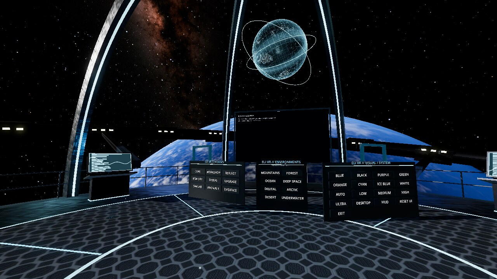
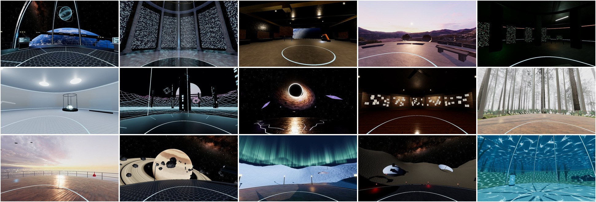
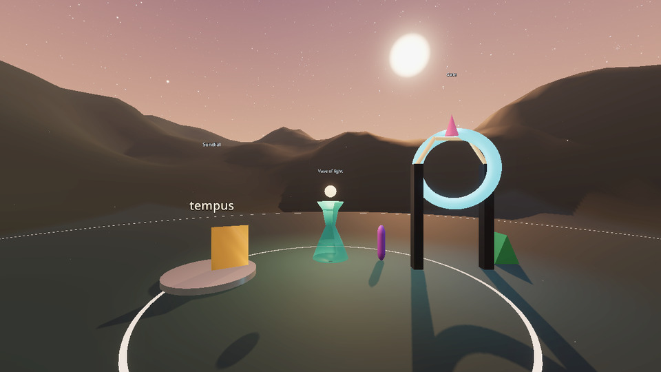

# ELI VR

A spatial workspace you can stand inside: fifteen places from an orbiting station to a misty forest, a movable live desktop screen, and a control console, built on Godot 4.7 and OpenXR. It runs in a headset, and it runs on a plain monitor when there isn't one.

**Version 0.9.12** · Linux · Windows · macOS



ELI VR is part of the ELI family but does not need ELI to run. With ELI v3 running beside it, ELI is present in the rooms and you can talk to ELI, and ELI v3 can open ELI VR itself as one of its bundles. There is no account, no telemetry and nothing leaves the machine.

## Status

This is an early build. Be clear-eyed about what has and has not been tried:

| | State |
|---|---|
| Linux, Wayland, Monado, Rift CV1 with Touch | The reference setup. Tested in the headset. |
| Flat (no headset) mode on Linux | Tested. |
| Windows and macOS builds | Built by CI. Not yet run on real hardware. |
| Valve Index, HTC Vive, Windows Mixed Reality, generic OpenXR controllers | Bound, not yet tested on hardware. |
| The link to ELI v3 (presence, talking) | Tested against ELI v3's own routes without a headset. Not yet used in one. |
| ELI building in the rooms, and ELI's own room | Tested flat against ELI v3's real server and a real, very small model. ELI's room was run in the headset; building has not yet been spoken into one. |
| Opened from ELI v3 as a bundle | Tested with ELI v3's own launch code and a stand-in for the app. Not yet opened that way into a headset. |
| Quest, Pico and other standalone headsets | No native app yet. Use them through a PC link (Link, Air Link, Virtual Desktop, ALVR, WiVRn). |
| macOS in VR | No common OpenXR runtime exists there. Flat mode only. |

If you run it on something not listed as tested, an issue saying what happened is genuinely useful.

## Install

Full step-by-step guides for every OS are in **[docs/INSTALL.md](docs/INSTALL.md)**. The short version:

**From a release build** (no Godot needed): download the archive for your OS from the [Releases](https://github.com/ShadowESC95/ELI_VR/releases) page, unpack it and run `ELI-VR`. On Linux there is also a one-file AppImage that starts everything and stops the VR runtime again when you leave.

**From source** (needs [Godot 4.7.2](https://godotengine.org/download)):

```bash
git clone https://github.com/ShadowESC95/ELI_VR.git
cd ELI_VR
./launch/run-linux.sh          # Linux
./launch/run-macos.command     # macOS
```

```powershell
.\launch\run-windows.ps1       # Windows
```

Each launcher takes a mode: `auto` (default), `xr`, `flat` or `compat` (OpenGL fallback for older GPUs). If Godot is not on your `PATH`, point `GODOT_BIN` at it.

With `auto`, ELI VR uses a headset when an OpenXR runtime is active and falls back to the flat window when it is not.

## Controls

### Flat mode

| Input | Action |
|---|---|
| Hold right mouse | Look |
| `W` `A` `S` `D` | Move |
| `Q` / `E` | Down / up |
| `F1` | Settings dock |
| `F2` | Desktop screen |
| `F3` | Performance HUD |
| `F5` | Rebuild the current room |
| Hold `T` | Talk to ELI (with the ELI link on) |
| `B` / `G` / `Z` | ELI builds something of its own in its room / makes up a game here / take the last change back |
| `Esc` | Release the mouse |

### In the headset

| Input | Action |
|---|---|
| Trigger | Press buttons, enter portals |
| Grip | Grab and move panels and objects (hold it; while held, the stick brings it nearer or turns it) |
| Trigger, pointing at the desktop | Move the desktop's pointer there and click |
| Right stick in / up / down, pointing at the desktop | Right-click / scroll |
| Grip on the desktop | Hold it: move the hand to move it round you, pull the hand in or push it out to bring it nearer or send it further, stick up or down to make it larger or smaller, left or right to flatten or curve it |
| Left stick | Move |
| Right stick | Snap turn |
| B / Y | Show or hide the spatial console |
| Menu (left) | Wrist menu |
| Hold A / X | Talk to ELI (with the ELI link on) |

Clicking on the desktop needs the desktop helper with your desktop's permission to take the pointer: on Linux under Wayland the screen-sharing dialog asks for it the first time, and it is remembered; macOS asks for Accessibility the first time you click. Without it the desktop is shown and not touched.

**Leaving:** press **EXIT** on the spatial console or the wrist menu twice, or **Exit ELI VR** in the settings dock (`F1`). Started through `./launch/eli-vr.sh` or the AppImage on Linux, closing ELI VR also stops the VR runtime it started, so no GPU memory stays held.

Oculus Touch is the tested layout. Valve Index, HTC Vive (trackpad stands in for the stick), Windows Mixed Reality and the OpenXR generic controller are mapped to the same actions. Anything else falls back to the OpenXR simple profile, which gives trigger and menu only.

## Environments

Fifteen places, each built as somewhere to be and none of them still.



The nine ELI rooms:

| Room | Where you are | What moves |
|---|---|---|
| Core Room | An open deck on a station in orbit, Earth below, the real Milky Way overhead | The station's outer ring, the hub, a projected globe, Earth's cloud |
| Memory Archive | A marble hall open to the stars, its walls shelved floor to roof with books, ladders on brass rails, reading corners lit by oil lamps, a librarian's desk, catalogue cabinets, a grandfather clock | A few books glow, brightening and fading; lights drift loose and rise; rings turn overhead |
| Workshop | A repair bay with its door open to space: benches with vices and toolboxes, and behind you the stores (shelves of crates, a tool chest, a drill press, a cart) under their own light | A welding arm, a crane on its rails, a beacon, Earth going by outside |
| Reflection Chamber | A stone terrace on a mountain plateau at dawn, ringed by still water | Birds, dust in the first light |
| Debug Basement | A concrete bunker of racks and old terminals: desks with CRT monitors, a laptop, meters and boards under test, power boxes and cables on the walls, caged lamps from the beams | Status lamps, scrolling logs, a roof fan, one strip light on its way out |
| Upgrade Bay | A clean white lab of panelled walls, a bank of glass-fronted racks across the far wall, a test bench and its microscope, shelves of parts, a storage cart and a welding cart | A printer building a part, crates on a belt, an arm sorting them; the racks' lights blink as hard as ELI is working |
| Simulation Lab | A world that is only being computed: grid, wire hills, towers of data | Everything |
| Anomaly Room | A cracked deck drifting towards a black hole | The disc of the hole, arcs between pylons, debris spiralling in |
| Evidence Wall | A dim studio with a long wall of pinned sheets strung with thread; behind you a desk under its lamp, a cabinet of files between racks of boxes, lamps on the walls | A fan, a projector changing slides, dust in the lamps |

Six more workspaces:

| Workspace | Where you are |
|---|---|
| Forest Sanctuary | A timber deck among tall pines in morning mist |
| Ocean Platform | A rig at sea at sunset; the water carries the sky |
| Deep Space Observatory | A platform beside a ringed giant, rocks tumbling past |
| Arctic Aurora | A snowfield at night under the northern lights |
| Desert Observatory | Dunes under the Milky Way, a dome and a dish at work |
| Underwater Research Lab | A glass dome on the seabed, kelp, shoals, shafts of light |

The night sky is NASA's star map and the Earth is NASA's Blue Marble. The forest, the mountain and the sunset are photographs of real places, laid on the ground so that what is near stays put as you move. Stone, wood, metal, snow and sand are scanned materials. All of it is free to use and listed in [assets/CREDITS.md](assets/CREDITS.md).

Eight themes set the colour of the lights in every room, and four quality profiles (`low`, `medium`, `high`, `ultra`) apply everywhere. On the reference setup, a mid-range desktop GPU, all fifteen hold the headset's 90 frames a second at `ultra`; `low` and `medium` are there for less. See [docs/ADVANCED-PLATFORM-OPTIMIZATION.md](docs/ADVANCED-PLATFORM-OPTIMIZATION.md).

## Live desktop screen

The screen shows your real desktop, at full resolution, curved round you. In the headset it is handed to the VR runtime's own compositor as a layer of its own, as dedicated VR desktop apps do, so its pixels are sampled once through the lenses rather than through the room's rendering first. Where the runtime has no such layer it is drawn in the room instead. It starts as sharp as your headset can show it, one desktop pixel to one pixel of the display, which makes it large; hold it with the grip to resize, curve and move it, and ELI VR remembers where you left it. The room never hides it, and your hands, the pointer, the console and ELI are drawn over it.

It needs a small capture helper running next to ELI VR; the app itself never captures anything. Frames travel over `127.0.0.1` only, and only to ELI VR run by the same person: the helper makes a new key each time it starts, readable by your account alone, and anything that connects without it is closed. It sends the screen whole once, then only the parts that change, and nothing while it is still.

| OS | Helper | Start it with |
|---|---|---|
| Linux, Wayland | Portal + PipeWire bridge (Python) | `./launch/start-desktop-bridge-linux.sh` |
| Linux, X11 | Native bridge (Rust) | `./launch/start-desktop-bridge-linux.sh` |
| Windows | Native bridge (Rust) | `.\launch\start-desktop-bridge-windows.ps1` |
| macOS | Native bridge (Rust) | `./launch/start-desktop-bridge-macos.command` |

Start the helper, then start ELI VR. The screen reconnects on its own. On Wayland the desktop asks once which monitor to share and remembers it. Setup per OS is in [docs/INSTALL.md](docs/INSTALL.md#live-desktop-screen).

Pointing and clicking reach your desktop on GNOME and KDE under Wayland (through the screen-sharing portal), on X11, on macOS and on Windows. On Windows it reaches the main display; another display is shown, not used. Wayland desktops whose portal cannot share the pointer (wlroots ones such as Sway) show the screen without it. Set `ELI_VR_DESKTOP_INPUT=0` before starting the helper to show the desktop and never touch it.

## With ELI v3

Off by default. Switch the link on and, while ELI v3's local server is running on the same machine:

- ELI appears as a body of light in whichever room its own world has it in, and the status line says where ELI is when that room is not yours. Light flows inside it, faster and more turbulent the more stirred ELI is, and brightens with its voice; a brighter point inside drifts toward you when ELI attends to you; motes of light circle it.
- ELI can relight any room of the house for good, of its own accord or because you asked: the room's glowing trims, strips, screens and points of light take the colour ELI chose. The air, the sky and the ground stay the room's own; how ELI feels shows on ELI.
- Its colour is how ELI feels: each expression ELI's world gives it (serene, curious, focused, cautious, concerned, beaming, downcast, angry and the rest) has its own, shaded by ELI's doubt, repair work, curiosity and load, and the light moves between them as the feeling changes. Only ELI's own glow reaches the space near it; the room is not washed in its colour.
- Hold **A** / **X** on a controller, or **T** on the keyboard, to talk to ELI. It answers in its own voice from where it stands.
- **ELI knows where it is.** ELI is told which room you are both in and what that place is, where you are standing, what you are looking at and which of its things are near. Ask "where are we" or "what am I looking at".
- **ELI can build.** Ask for something, "build me a tall red pillar", "put a lamp to my left", "make the pillar green and bigger", "undo", and the thing rises out of the floor where you asked. You can grab what ELI made and move it. Everything ELI does goes through its world's own policy and is kept in that world's ledger.
- **ELI makes games.** "Let's play a game", "set up a catch game", "hide something for me to find", or ELI: PLAY on the console, and ELI makes up a small game for the room you are in: targets to hit, things to catch as they come down, pieces to sort onto their mats, lights to hit in the order shown, or something hidden to find, with pieces, colours, counts, time and lines of ELI's own choosing, from the room, its memories and how you did last time. The pieces are ELI's things; the score goes back to ELI's world, is journalled and remembered, and the next game answers the last.
- **In any way ELI likes.** A thing is a shape by name, or anything at all made part by part: boxes, balls, cones, rings, a profile turned on a lathe, an outline pulled up into a solid, a tube along a path, text, each with its own place, turn, size, colour, metal, glow, clearness and motion. Nothing has to come from a list.
- **ELI has a room of its own.** ELI'S ROOM on the console is open ground under an open sky with nothing there but what ELI has made. The sky is ELI's to choose: one by name, or painted from two colours, stars and a sun placed wherever ELI likes. So is the ground: any colour, flat or rising into hills.
- **Of its own accord, from its own life.** Nothing is scheduled and nothing is chosen for ELI. When something happens in ELI (an insight forms, a goal is taken on or finished, an improvement to itself is proposed) that moment is kept in its own words. When ELI is free it may make something of that moment in its room, and what ELI makes is tied to the record the moment came from. ELI: BUILD asks now.
- **ELI lives in its rooms.** Its light moves: it goes among what is its in the room (what it made, its memories, goals and beliefs) and stops to look at each; it comes to you while you talk to it, while it thinks about what you said and while it answers; when it makes or changes something it goes there and pours its light into it while it grows; when it relights a room it rises to the middle while the light changes; and when ELI's world puts it in another room it rises and fades away, with a word on where it went, and flies back in when it returns.
- **ELI's thoughts rise from it.** Now and then, while it is on its own or thinking, a line of what is on its mind rises from its light and fades: its latest insight, a moment of its own waiting to be made into something, the goal it holds first, its tone. They are ELI's records' own words, more often while it thinks, never while it talks with you.
- **ELI acts while you are there.** When a moment of its own is waiting and ELI is free (a model already in memory, nobody's mood asking it to hold back), ELI makes something of it while you watch, in whichever room of its house it chooses. Never while you talk to it, one at a time, and after each one you have been quiet three times as long as it took before the next.
- **The screens are true.** Every screen in the house shows ELI as it is, never made-up text: the Core Room's consoles show what ELI is doing, its own measures of itself, its log, what it did lately and why, and what is on its mind; the Debug Basement's wall carries ELI's whole log and each terminal one strand of it (troubles, reasoning, recall, work); the Upgrade Bay shows its goals and ambitions and the improvements it proposed and made; the Workshop what its tools did; the Evidence Wall's projector the questions ELI is waiting on you to settle. Without ELI they say so.
- **ELI's records stand in its rooms.** The Memory Archive has ELI's real recent memories stood face out on the shelves ahead of you at eye height, each a book with what ELI remembers written on its cover. The Upgrade Bay holds the goals ELI has now. The Evidence Wall has what ELI believes about you pinned to its boards, each sheet written with what ELI believes and since when, and the Anomaly Room each thing ELI was told two ways, with the question that would settle it.
- **What ELI does for you shows up in its house.** What it found for you (a web search with its top results and their sites, the news, the weather) is printed and pinned on the board over the Evidence Wall's desk; what it wrote (a document, a file) is clipped to the rack in the Workshop with its opening lines; the radio on the low table in the Core Room plays what ELI is playing, its name and artist on a card above it, paused when you paused it; the pictures ELI took or looked at for you are pinned up as photographs on the board beside the desk, each with what ELI saw; and a screen on the Core Room's deck shows what is coming up on your agenda.
- **ELI acts of its own accord.** Besides its insights, goals and troubles, what it just did for you (a search, a song, a document, a picture) and the turn of the day (morning, afternoon, evening, night) are moments ELI may make something of in its house, or leave be.



```bash
python3 tools/eli_vr.py eli on            # remembered
./launch/run-linux.sh -- --eli-link=on    # this run only
```

### ELI's mind

ELI VR names no model and assumes none. Which GGUF is ELI's mind is your choice, three ways:

- **Opened from ELI v3's window:** the model already loaded there is the one that answers. Nothing is chosen again and nothing is loaded twice.
- **In the room:** the ELI'S MIND panel lists the models ELI has, by its own list. The one in use is marked. Press another and ELI loads it.
- **Before starting:** `--eli-model=<name>` for that run, or `python3 tools/eli_vr.py model <name>` to keep it. A kept model is asked for only when ELI has nothing loaded yet.

The status line always says which model ELI is using, and says so when that is only the one used last and nobody chose it.

Building is held to an exact grammar and checked against what you plainly said, so it works with a very small model too. A model of three billion parameters or more is also offered everything: things made part by part and a sky painted its own way. A smaller one keeps to the named shapes, which it can manage.

If something goes wrong the status line says which thing: ELI is not running, ELI has no model loaded, ELI did not catch that, ELI's voice is not available, or this ELI v3 is too old for building. Building, ELI's room, ELI's mind and ELI knowing where it is need ELI v3 3.0.134 or newer. An older one (3.0.131 to 3.0.133) still gives presence and talking.

### Opened from ELI v3

ELI v3 lists the ELI applications installed beside it and opens them, at start-up, from its Bundles menu or with `eli --bundle vr`. ELI VR is one of those bundles, the same way ELI Legal is. ELI VR puts itself on ELI v3's list each time it starts, when ELI v3 is installed on the machine, so a moved or updated copy is the one ELI v3 opens; ELI v3 also finds a copy left on the desktop, in Downloads or in an applications folder, and its Bundles menu offers to find one that is elsewhere. Registering by hand still works:

```bash
./ELI_VR-*-x86_64.AppImage --register-eli     # the AppImage
./launch/eli-vr.sh --register-eli             # a Linux download or checkout
python3 tools/register_eli_bundle.py          # any OS
```

Opened that way, ELI v3 has its local server answering first. The link to ELI is on by itself wherever ELI v3 is installed (`--eli-link=off` turns it off); opened on its own, ELI VR reaches ELI when ELI v3's server is running and keeps trying quietly until it is. Details in [docs/ELI_INTEGRATION.md](docs/ELI_INTEGRATION.md).

## Settings

Defaults live in `config/defaults.json`. Changes made in the app are saved per user, outside the project. To override defaults for a source checkout, copy `config/user.example.json` to `config/user.json`.

There is also a small CLI:

```bash
python3 tools/eli_vr.py rooms
python3 tools/eli_vr.py themes
python3 tools/eli_vr.py room reflection_chamber
python3 tools/eli_vr.py environment ocean_platform
python3 tools/eli_vr.py theme nebula
python3 tools/eli_vr.py quality high
python3 tools/eli_vr.py xr auto
python3 tools/eli_vr.py desktop on
python3 tools/eli_vr.py show
```

More in [docs/SETTINGS.md](docs/SETTINGS.md) and [docs/COMMANDS.md](docs/COMMANDS.md).

## Offline by design

ELI VR does not need the internet to run. No sign-in, no account service, no telemetry, no analytics, no cloud sync, no runtime downloads and no update checks.

The only sockets are on the local machine:

```text
127.0.0.1:47831   desktop capture bridge
127.0.0.1:8081    ELI v3's local server, only when the ELI link is on
```

Installing Godot, OS packages or Rust crates the first time does use the network. See [docs/NETWORK-POLICY.md](docs/NETWORK-POLICY.md).

## Documentation

| | |
|---|---|
| [docs/INSTALL.md](docs/INSTALL.md) | Install and first run on Linux, Windows and macOS |
| [docs/SETTINGS.md](docs/SETTINGS.md) | Every setting |
| [docs/COMMANDS.md](docs/COMMANDS.md) | CLI and tool commands |
| [docs/ARCHITECTURE.md](docs/ARCHITECTURE.md) | How the pieces fit |
| [docs/PLATFORM_SUPPORT.md](docs/PLATFORM_SUPPORT.md) | What runs where |
| [docs/ADVANCED-PLATFORM-OPTIMIZATION.md](docs/ADVANCED-PLATFORM-OPTIMIZATION.md) | Quality profiles and performance |
| [docs/NETWORK-POLICY.md](docs/NETWORK-POLICY.md) | What ELI VR may connect to |
| [docs/QUICKSTART-UBUNTU-CV1.md](docs/QUICKSTART-UBUNTU-CV1.md) | The Ubuntu + Monado + Rift CV1 reference setup |
| [docs/ELI_INTEGRATION.md](docs/ELI_INTEGRATION.md) | The link to ELI v3, and ELI VR as an ELI v3 bundle |
| [assets/CREDITS.md](assets/CREDITS.md) | Where the art comes from |
| [tools/README.md](tools/README.md) | The helper tools |
| [docs/ROADMAP.md](docs/ROADMAP.md) | What comes next |
| [RELEASE.md](RELEASE.md) | How a release is cut |

The other files in `docs/` are per-version notes, kept as history.

## Working on it

```bash
python3 -m pip install -r requirements.txt
python3 tools/source_sanity.py       # catches mangled GDScript
python3 tools/validate_project.py    # project structure and assets
python3 tools/network_audit.py       # no remote URLs in runtime code
python3 -m unittest discover -s tests   # the ELI v3 bundle side
./tools/godot_parse_check.sh         # Godot loads every script
python3 tools/make_release.py --check
```

The last one scans what would be published for personal data and machine paths.

## Licence

ELI VR is proprietary commercial software, © 2026 Jason Fitzgibbon Bridgeman, all rights reserved.
It is licensed only under the ELI End User Licence Agreement and the ELI VR Product Schedule, set out
in full in [LICENSE](LICENSE) and shipped in every package: a licence to ELI VR bought on its own, or
an ELI v3 licence that includes it. The schedule includes VR's health and safety terms. Third-party
components, including the Godot Engine and your OpenXR runtime, keep their own licences.

A release build asks for your key the first time it opens: see [Your licence](docs/INSTALL.md#your-licence).
